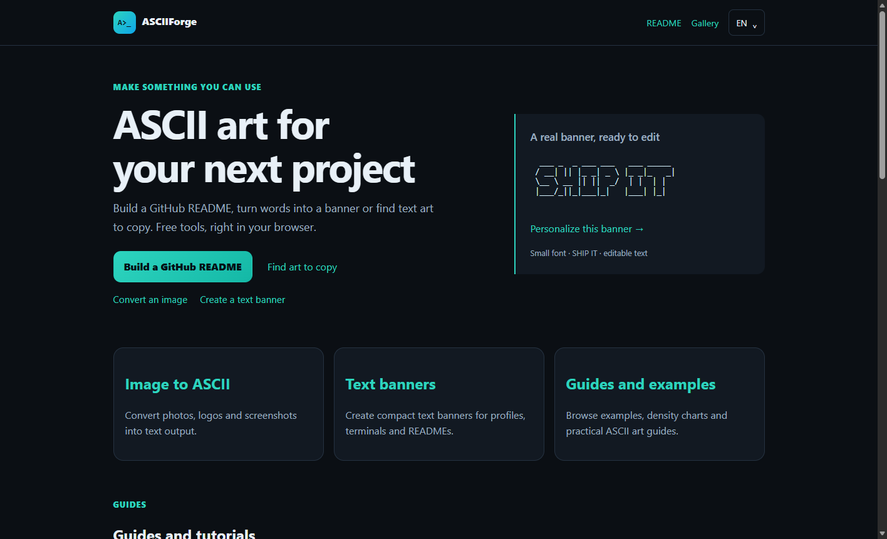
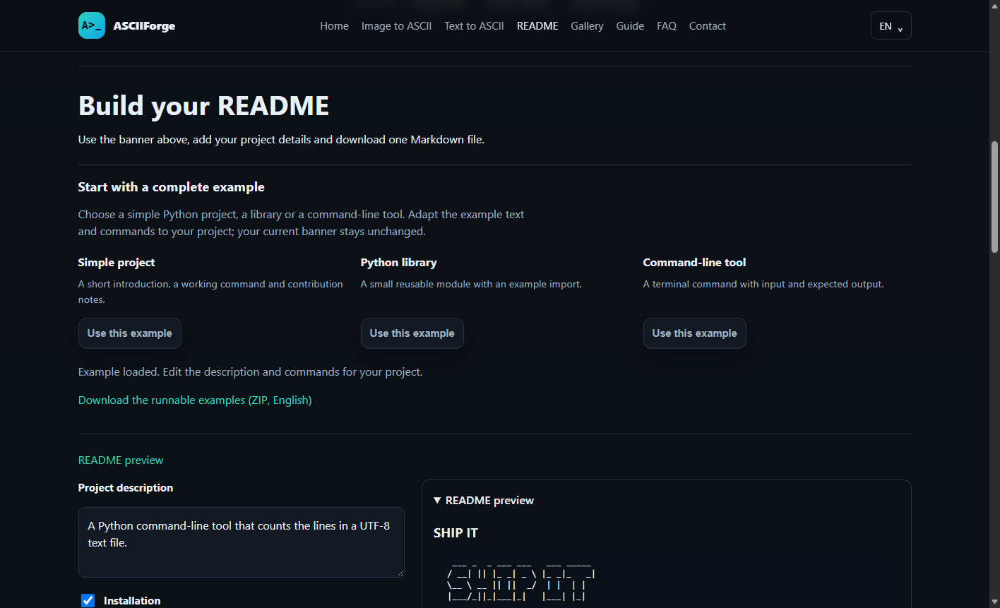

# ASCIIForge · README Examples

**Tre piccoli progetti Python per mostrare README chiari, eseguibili e riconoscibili.**

 

[Esempi](#esempi) · [Avvio rapido](#avvio-rapido) · [Crea il tuo README](#crea-il-tuo-readme) · [Anteprime](#anteprime) · [Licenza](#licenza)

Ogni esempio abbina un banner ASCII creato con [ASCIIForge](https://asciiforge.com/en/ascii-for-github-readme/?utm_source=github&utm_medium=referral&utm_campaign=readme_examples) a una descrizione breve, un comando reale e il risultato atteso.

## Esempi

| Progetto | Cosa mostra | Comando dalla sua cartella | Risultato atteso |
| --- | --- | --- | --- |
| [Hello Project](simple-project/README.md) | README essenziale per un primo progetto | `python hello.py` | `Hello, ASCIIForge!` |
| [Text Slug](python-library/README.md) | Modulo riutilizzabile e un esempio di import | `python example.py` | `hello-asciiforge` |
| [Line Count](command-line/README.md) | CLI con input da file | `python line_count.py sample.txt` | `3 lines` |

## Avvio rapido

Servono **Python 3.9 o successivo** e la libreria standard, senza pacchetti aggiuntivi.

```sh
git clone https://github.com/Enzuccio993/asciiforge-readme-examples.git
cd asciiforge-readme-examples/simple-project
python hello.py
```

Per gli altri esempi, apri la rispettiva cartella e segui il README. Su alcuni sistemi il comando Python è `python3` o `py`.

## Crea il tuo README

1. Apri l'[editor README](https://asciiforge.com/en/ascii-for-github-readme/?utm_source=github&utm_medium=referral&utm_campaign=readme_examples).
2. Inserisci il nome, scegli un font e controlla la larghezza del banner.
3. Scegli uno starter e sostituisci descrizione, requisiti e comandi con quelli reali.
4. Copia il Markdown o scarica `README.md`, poi controlla l'anteprima su GitHub.

Puoi anche creare un [banner di testo](https://asciiforge.com/en/text-to-ascii/) e portarlo nell'editor. Mantieni nome e istruzioni in testo normale: il banner è un elemento visivo.

I link di modifica dei banner contengono il testo e le impostazioni del banner; non includono descrizione e comandi inseriti nell'editor README.

## Anteprime

<details>
<summary>Homepage e editor README</summary>





</details>

## Stato degli esempi

Esempi didattici volutamente piccoli, ciascuno con una funzione e un output atteso. Mostrano la struttura di un README e non rappresentano applicazioni complete da distribuire.

## Licenza

Codice e documentazione sono distribuiti con [licenza MIT](LICENSE). I banner usano il font Small FIGlet: consulta i [crediti del font](https://asciiforge.com/assets/fonts/figlet/Small.flf) per le attribuzioni originali.

---

A cura di [Enzuccio993](https://github.com/Enzuccio993).
